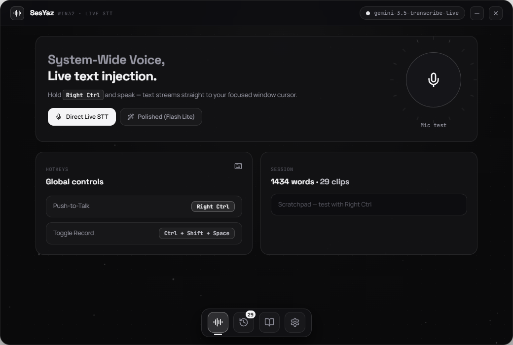
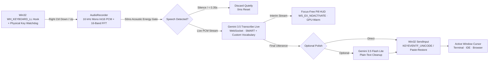

# SesYaz

**System-wide Windows voice-to-text auto-typer built for Azerbaijani and English code-switching workflows.**

[](#)
[](#)
[](LICENSE)



---

## Why I Built This

Windows lacks native Azerbaijani speech-to-text, and developer workflows require constant code-switching between Azerbaijani sentences and English technical terms (`TypeScript`, `PySide6`, `git commit`, `Vercel`, `Claude Code`, APIs, symbol names). Recording voice notes in a separate web tab and manually copy-pasting breaks flow inside terminals, editors, and CLI agents.

**SesYaz** solves this at the OS level: hold a single global key (`Right Ctrl` by default) anywhere in Windows, speak naturally, watch live interim words appear in a non-focus-stealing capsule overlay, and release to inject the finalized Unicode text (`ə, ş, ğ, ç, ö, ü, ı` + technical vocabulary) straight at the active cursor.

---

## Architecture



### Key Engineering Decisions

- **Streaming WebSocket (`gemini-3.5-transcribe-live`) over Batch REST (`gemini-3.5-transcribe`)**
  - Batch file transcription incurs post-speech upload latency and a tight 25 RPD free-tier ceiling.
  - Streaming 16 kHz PCM frames over `v1beta` Live API with manual VAD (`ActivityStart` / `ActivityEnd`), `mode="SMART"`, `language_codes=["az", "en"]`, and `custom_vocabulary` biasing delivers live interim feedback while speaking, `< 1s` commit latency on key release, and unlimited request/day throughput.
- **Acoustic Energy Gate + Hook Watchdog**
  - `AudioRecorder.stop()` computes peak amplitude (`>= 0.012`) and 95th-percentile 50 ms frame RMS (`>= 0.0035`) before committing, preventing silent or accidental taps (`< 0.35 s`) from triggering API calls or hallucinated output.
  - `GlobalHotkeyListener` filters `LLKHF_INJECTED` synthetic events and polls physical key state via `GetAsyncKeyState` every `100 ms`, eliminating stuck push-to-talk states when another window or elevation prompt consumes `WM_KEYUP`.
- **Zero-Clipboard & Clipboard-Safe Win32 Text Injection**
  - Short single-line utterances (`<= 140` chars) inject directly via `SendInput` (`KEYEVENTF_UNICODE`), leaving the user's clipboard untouched (`Shift+Enter` for inline newlines so chat/CLI inputs do not submit prematurely).
  - Longer multi-line paragraphs temporarily set `CF_UNICODETEXT`, trigger `Ctrl+V`, and restore the previous clipboard after delivery.
- **GPU-Warm Overlay HUD (`PySide6 QtWebEngineWidgets` + React / Framer Motion)**
  - Calling `.hide()` / `.show()` on QtWebEngine suspends Chromium's GPU compositor and causes noticeable first-frame lag. Keeping the transparent pill mapped at `windowOpacity(0.0)` with `WS_EX_NOACTIVATE | WS_EX_TOOLWINDOW | WS_EX_TRANSPARENT` gives instant (`< 1 ms`), click-through overlay transitions without stealing focus from terminals or editors.
- **Standalone Windows Binary (`PyInstaller`)**
  - Packages Python, QtWebEngine, local static UI (`app/ui_dist`), audio drivers, and app icon into a single native `SesYaz.exe` with single-instance Windows Mutex + Named Event wake-up and `HKCU\...\Run` startup registration.

---

## Project Structure

```text
sesyaz/
├── app/
│   ├── main.py            # Tray daemon, Win32 overlay windows, recording lifecycle
│   ├── win32_io.py        # WH_KEYBOARD_LL hook, watchdog, SendInput / clipboard I/O
│   ├── audio_engine.py    # 16kHz PCM capture, 16-band FFT spectrum, energy VAD gate
│   ├── transcriber.py     # LiveTranscribeStreamer (WebSocket) + batch/polish fallback
│   ├── config.py          # %LOCALAPPDATA%\SesYaz config/history & key discovery
│   ├── server.py          # Localhost HTTP + SSE bridge for Studio & Pill views
│   └── ui_dist/           # Production Vite/React bundle served locally
├── frontend/              # React 19 + TypeScript + Tailwind v4 + Framer Motion UI
├── build_exe.ps1          # Builds frontend + bundles SesYaz.exe via PyInstaller
├── requirements.txt
└── LICENSE                # MIT License
```

---

## Running from Source

### Prerequisites
- Windows 10 / 11
- Python 3.12+
- Node.js 20+
- Gemini API key (`GEMINI_API_KEY` environment variable or added inside Settings)

### Development Setup

```powershell
# 1. Build frontend UI bundle
cd frontend
npm install
npm run build
cd ..

# 2. Install Python dependencies
pip install -r requirements.txt

# 3. Launch desktop app
python app/main.py
```

### Build Native Windows Executable (`SesYaz.exe`)

```powershell
powershell -NoProfile -ExecutionPolicy Bypass -File .\build_exe.ps1
```

This bundles everything into `%LOCALAPPDATA%\Programs\SesYaz\SesYaz.exe` and creates Desktop and Start Menu shortcuts.

---

## Default Controls

| Action | Default Binding | Behavior |
| :--- | :--- | :--- |
| Push-to-Talk | `Right Ctrl` (hold) | Streams audio while held; inserts text on release |
| Hands-Free Toggle | `Ctrl + Shift + Space` | Starts listening on first press; commits on second |
| Settings & Vocabulary | System Tray Icon | Configure mic device, custom hotkeys, API keys, and term biasing |

---

## License

Released under the [MIT License](LICENSE). Copyright (c) 2026 Elcan Səfərli.
